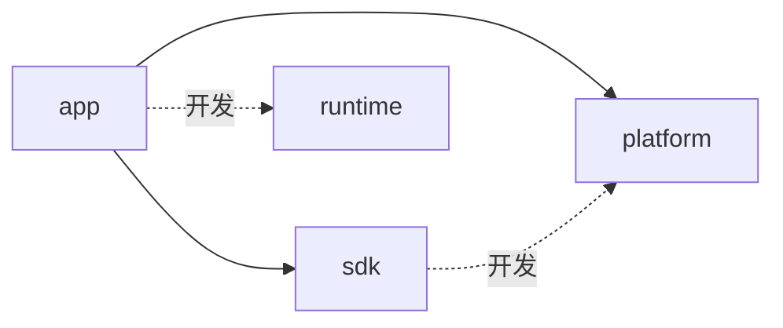
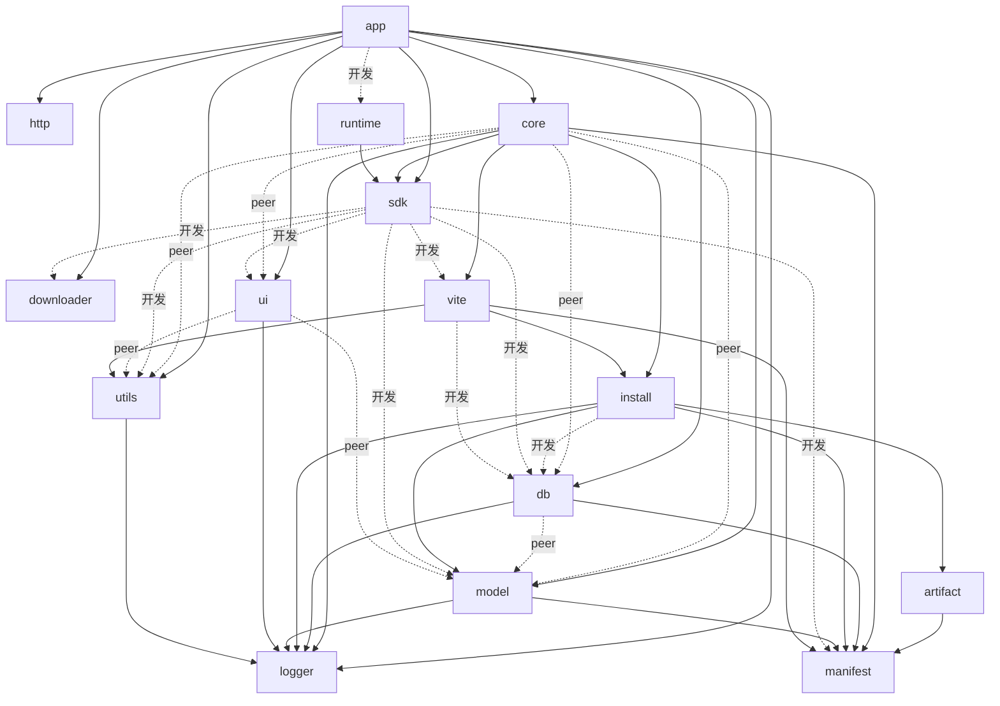
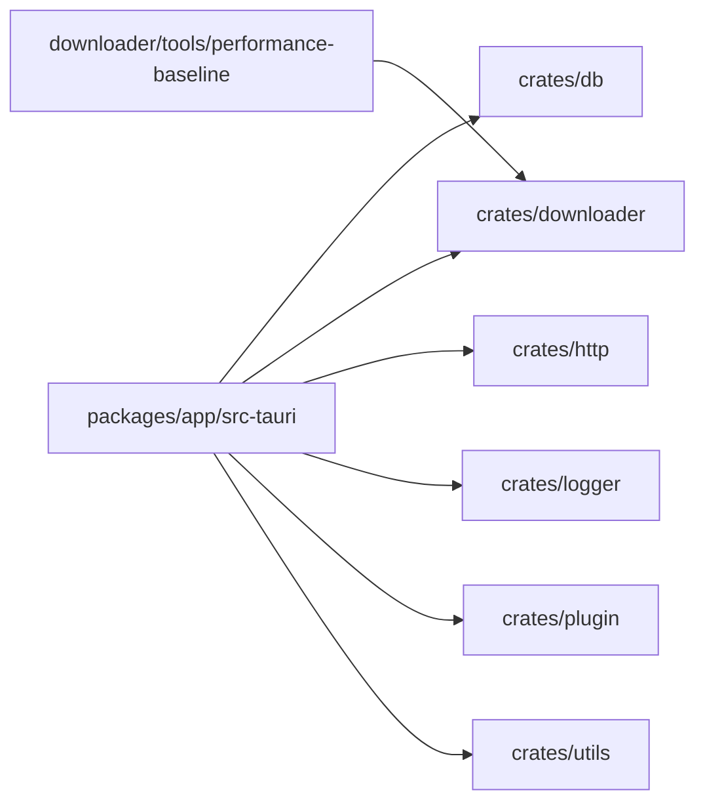

# Delta Comic 工作区依赖图

箭头从使用方指向依赖。包节点使用 `packages/` 下的目录名，`sdk` 发布为 `@delta-comic/client`。统计包含直接的运行、开发和 peer 依赖，同一包内的导入及第三方依赖不计入。

## 当前结构 · 4 个产品包，4 条包间依赖

| 包 | 职责 |
| --- | --- |
| app | Vue/Tauri 应用、UI、插件宿主、安装与校验 |
| sdk | 对外的插件 API、开发服务器和打包工具 |
| platform | 宿主和 SDK 使用的模型、协议、数据、原生接口及构建桥接模块 |
| runtime | 预构建 UMD，共享 Vue、路由、状态管理、Naive UI 与 Cordis 实例 |

SDK 将使用的 platform 代码和声明打包。宿主在启动插件前通过 UMD 桥接暴露同一份 SDK。两个工具包位于 `script/codegen` 和 `script/manager`，由根工作区调用。

## 合并前 · 15 个产品包，46 条包间依赖

基线为 `650aaf2c` 的各包清单。artifact 并入安装模块，core、install、ui 并入 app，vite 并入 sdk。db、downloader、http、logger、manifest、model、utils 并入 platform。

## Cargo 工作区 · 8 个成员

原始清单中已有 6 个 Tauri 插件，成员路径仍指向目录扁平化前的位置。现已移至 `crates/`。每个插件有自己的 Cargo 构建脚本和 Tauri 注册入口。

