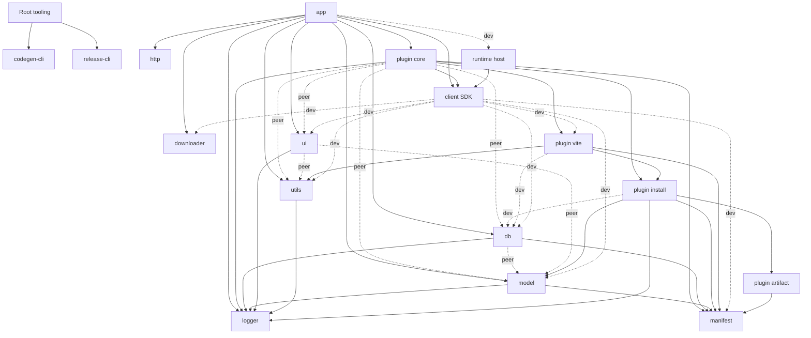
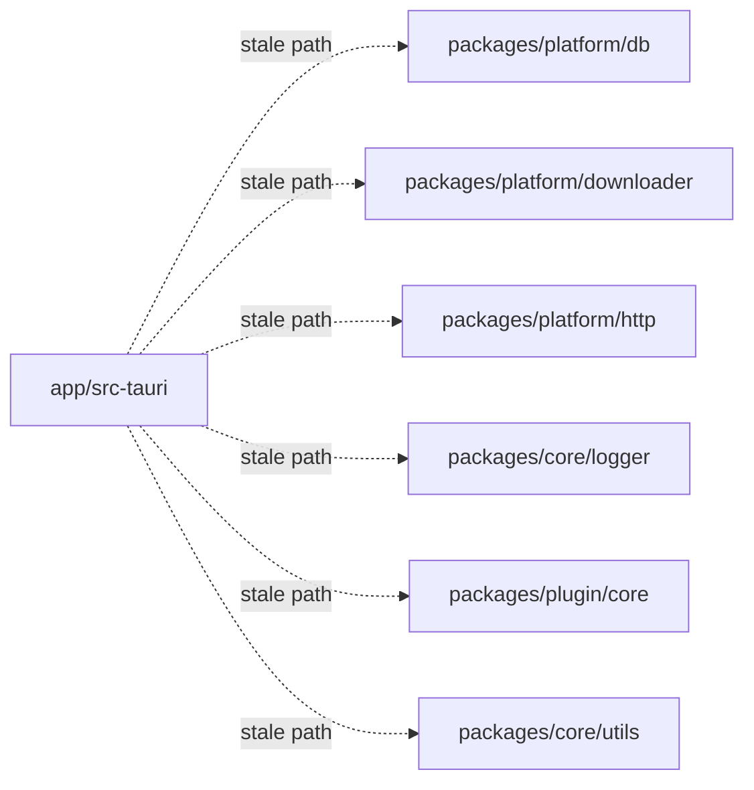

# Monorepo dependency map

This map reflects the workspace package manifests and Rust path configuration at `develop` commit `650aaf2c`.

## JavaScript workspace

Solid arrows are declared workspace dependencies. Dotted arrows are peer dependencies. Dashed arrows are development-only dependencies.

## Rust workspace paths

The Rust workspace declarations below still point at the pre-flattening layout. Those directories are absent in this checkout. The matching crates currently live directly under `packages/`.

## Additional stale references

- Root TypeScript project references still name the pre-flattening Rust and UI package paths.
- The client SDK's Vite aliases still point at the pre-flattening db, downloader, manifest, and UI paths.
- Release discovery and codegen checks still reference the pre-flattening package locations.
- The lockfile records workspace links to package paths that no longer exist.

